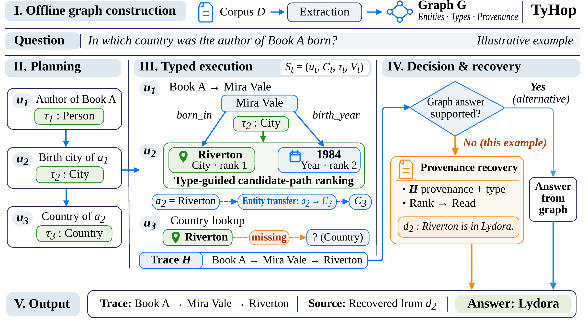

# TyHop: Type-Guided Subquestion Reasoning for Multi-Hop Question Answering over Knowledge Graphs

**Anonymous research code release**

## Abstract

Multi-hop question answering over automatically constructed knowledge graphs
requires a model to decide what to search for, where to start, and whether the
retrieved graph evidence is sufficient. TyHop addresses these decisions through
ordered typed subquestion states. Each state contains a local subquestion, one or
more resolved start entities, and a target answer type. The answer of a preceding
state can be aligned to a graph entity and transferred as the search start of a
dependent state. Candidate paths are ranked and validated with the target type of
the current subquestion. When graph evidence is incomplete, TyHop follows the
provenance of visited entities and adopted relations back to source passages and
continues answering with the intermediate results already collected.

This repository contains the main graph-construction and reasoning
implementation used to obtain the reported TyHop results. It is intentionally
limited to the reported pipeline and excludes unrelated baselines, ablation-only
entry points, and unpublished experimental branches.

## Method Overview

TyHop consists of two stages: offline graph construction and online typed
subquestion reasoning.

<p align="center">
  
</p>

*Figure 1. Overview of TyHop. Offline graph construction produces an entity and
relation graph with entity types and provenance. Online execution decomposes the
question into ordered typed subquestions, transfers intermediate answer entities
between dependent states, ranks candidate paths with the current target type, and
recovers source evidence from the execution trace when graph evidence is
insufficient. A vector version is available in
[PDF](docs/figures/tyhop_method_publication.pdf).*

The figure corresponds to five stages:

1. **Offline graph construction** extracts entities, relations, entity types, and
   source provenance from the controlled corpus.
2. **Planning** decomposes the original question into dependency-ordered
   subquestions with start hints and target types.
3. **Typed execution** searches local paths, ranks candidates with the current
   target type, resolves intermediate entities, and transfers the resolved answer
   to the next dependent state.
4. **Decision and recovery** accepts a supported graph answer or follows the
   trace provenance back to source text when the graph is incomplete.
5. **Output** reports the reasoning trace, the evidence source, and the final
   answer.

### 1. Offline Graph Construction

Each source sample is transformed into a provenance-aware knowledge graph.

1. Parse the benchmark context into passage-level blocks.
2. Use an LLM to extract six-field triples:

   ```text
   (subject, subject_type, relation, target, target_type, relation_context)
   ```

3. Deduplicate triples within the source sample.
4. Cluster high-similarity entity mentions and ask an LLM to choose canonical
   entity names and types.
5. Add a small set of explicit high-precision relations, including
   `named_after`, `spouse`, `father_of`, and `child_of`.
6. Store extracted entity types directly as type attributes and type-vector
   entries.
7. Write entity and relation data with source sample identifiers attached as
   provenance.

The reported pipeline does not use cross-passage relation completion, a separate
type-relation reasoning graph, or a post-hoc graph quality-repair stage.

### 2. Typed Subquestion Reasoning

Given a question, TyHop executes the following steps:

1. Predict the expected answer type and align the prediction with graph types.
2. Retrieve topic entities and use them as initial search seeds.
3. Decompose the question into up to four ordered subquestions.
4. Assign each subquestion a start-entity hint and target answer type.
5. Enumerate bounded local graph paths from the current start entities.
6. Rank and select hops according to the current subquestion and target type.
7. Align a resolved intermediate answer to graph entities and transfer it to the
   next dependent subquestion.
8. Validate the final graph answer against the expected answer type.
9. If the graph branch fails, rank source passages using provenance votes and
   answer from the recovered source text.

The final result records the answer source, predicted and recalled types,
candidate type context, selected paths, explored depth, source votes, fallback
candidates, and answer-grounding information.

## Reported Results

We report exact match (EM) and token-level F1 on fixed 500-question evaluation
subsets.

| Method | HotpotQA EM | HotpotQA F1 | 2WikiMultiHopQA EM | 2WikiMultiHopQA F1 | MuSiQue EM | MuSiQue F1 |
|---|---:|---:|---:|---:|---:|---:|
| LLM-only | 18.6 | 25.2 | 21.4 | 26.0 | 6.8 | 9.4 |
| LLM-RAG | 55.6 | 67.8 | 22.0 | 25.6 | 11.8 | 16.5 |
| HippoRAG 2 | 49.0 | 64.0 | 26.6 | 33.9 | 15.8 | 23.7 |
| KG²RAG | 52.6 | 66.1 | 54.0 | 63.2 | 23.0 | 36.7 |
| KET-RAG | 32.2 | 40.3 | 29.2 | 36.1 | 6.8 | 10.1 |
| SubQRAG | 47.4 | 60.0 | 37.8 | 43.1 | 24.0 | 33.4 |
| IRCoT | 49.2 | 61.8 | 52.4 | 59.0 | 11.0 | 16.7 |
| ChainRAG | 43.2 | 58.3 | 45.0 | 55.1 | 22.8 | 34.2 |
| **TyHop** | **57.2** | **71.4** | **67.0** | **75.7** | **28.6** | **38.8** |

### Main Observation

TyHop obtains the highest reported EM and F1 on all three evaluation subsets.
Relative to the strongest listed baseline on each dataset, the reported F1
improvements are:

- HotpotQA: `71.4 - 67.8 = 3.6`
- 2WikiMultiHopQA: `75.7 - 63.2 = 12.5`
- MuSiQue: `38.8 - 36.7 = 2.1`

These results are obtained in a controlled source-context setting and should not
be interpreted as open-web or full-Wikipedia performance.

### Reported Result Identifiers

| Dataset | Result experiment | Graph experiment |
|---|---:|---:|
| HotpotQA-hard | 343 | 338 |
| MuSiQue 3/4-hop | 344 | 344 |
| 2WikiMultiHopQA | 345 | 345 |

The main TyHop configuration uses:

```text
search=subquestion
width=6
depth=5
fallback-context-limit=3
full-context-fallback=true
ground-answer-entity=true
```

## Module Ablation

The complete-mechanism ablations reported with the paper are:

| Dataset | Full TyHop F1 | No subquestion F1 | No type mechanism F1 |
|---|---:|---:|---:|
| HotpotQA | 71.4 | 62.3 | 60.7 |
| MuSiQue | 38.8 | 26.8 | 24.2 |
| 2WikiMultiHopQA | 75.7 | 51.3 | 48.1 |

The subquestion ablation changes decomposition, local search states,
intermediate-answer transfer, and search starts together. The type ablation
removes type prediction, search-stage type scoring, terminal validation, and
type-informed source ordering. The measurements therefore support the complete
mechanisms rather than isolated components.

## Repository Structure

```text
src/main/java/org/example/
├── config/                  Configuration loading
├── constants/               LLM prompt templates
├── entity/                  Database and result records
├── experiment/
│   ├── DataItem.java        Sample state
│   ├── DataLoader.java      Experiment data loader
│   ├── GraphBuild/          Graph construction
│   └── ours/                TyHop reasoning pipeline
├── infrastructure/          LLM, Neo4j, Redis, and MySQL clients
├── mapper/                  MyBatis mappers
├── mp/                      Experiment repository
└── utils/                   Metrics, sanitization, parsing, and persistence
```

Key files:

- `GraphBuild.java`: passage splitting, triple extraction, entity resolution,
  explicit relation augmentation, direct type storage, and provenance writes.
- `OurMethodReasoning.java`: typed subquestion planning, bounded graph search,
  intermediate-entity transfer, answer validation, and provenance fallback.
- `Neo4jClient.java`: graph, type-vector, provenance, and context persistence.
- `Metrics.java`: exact match and token F1.

## Configuration

No deployment address, account, password, key, index name, or database name is
stored in the repository. Provide all deployment-specific values through
environment variables or JVM system properties.

Core variables:

```text
DASHSCOPE_BASE_URL
DASHSCOPE_API_KEY
DASHSCOPE_MODEL
NEO4J_URI
NEO4J_USERNAME
NEO4J_PASSWORD
NEO4J_DATABASE
NEO4J_ENTITY_VECTOR_INDEX
NEO4J_RELATION_VECTOR_INDEX
NEO4J_TYPE_VECTOR_INDEX
REDIS_HOST
REDIS_PASSWORD
REDIS_KEY_PREFIX
EMBEDDING_BASE_URL
EMBEDDING_INDEX_NAME
MYSQL_HOST
MYSQL_USER
MYSQL_PASSWORD
MYSQL_DATABASE
```

Configuration precedence is:

1. JVM system property
2. Environment variable
3. Empty default

The application does not load a `.env` file automatically.

## Build

Requirements:

- Java 17 or newer
- Maven 3.9 or newer
- Neo4j with native vector-index support
- Redis with Search support
- MySQL
- An Ollama-compatible EmbeddingGemma endpoint
- An OpenAI-compatible chat-completion endpoint

Run tests:

```bash
mvn test
```

Build classes:

```bash
mvn compile
```

## Reproducing the Main Run

Run an existing experiment:

```bash
mvn exec:java \
  "-Dexec.mainClass=org.example.experiment.ours.OurMethodReasoning" \
  "-Dexec.args=--experiment-id=<id> --build-graphs=false --threads=1"
```

HotpotQA result experiment `343` reuses graph experiment `338`:

```bash
mvn exec:java \
  "-Dexec.mainClass=org.example.experiment.ours.OurMethodReasoning" \
  "-Dexec.args=--experiment-id=343 --graph-experiment-id=338 --build-graphs=false --threads=1"
```

For MuSiQue experiment `344` and 2WikiMultiHopQA experiment `345`, the result and
graph namespaces are the same. Graph construction can be enabled with
`--build-graphs=true`.

The command-line entry point always executes the reported subquestion path.

## Graph Persistence Semantics

All samples in one benchmark dataset share a graph namespace. Each entity and
relation retains the contributing `data_set.id` values in
`dataset_id_list`. This allows cross-sample graph search while preserving the
source context associated with every graph element.

Entity identity is scoped by:

```text
experiment_id + dataset_id + normalized entity name + normalized entity type
```

Relation identity is scoped by:

```text
experiment_id + dataset_id + subject + relation + target
```

Before a sample is rebuilt, its previous edges are removed. Query-time reasoning
does not modify the graph.

## Evaluation Notes

- Metric normalization and token F1 follow `Metrics.java`.
- All methods are evaluated on the same frozen question identifiers for each
  dataset.
- The reported results are single runs without confidence intervals or paired
  significance tests.
- SubQRAG, IRCoT, and ToG-2 numbers from the comparison table should be described
  as adapted implementations rather than strict official reproductions.
- Questions and source contexts come from controlled benchmark-specific corpora;
  the results do not establish open-web generalization.

## Citation

```bibtex
@misc{tyhop2026,
  title  = {TyHop: Type-Guided Subquestion Reasoning for Multi-Hop Question Answering over Knowledge Graphs},
  author = {Anonymous},
  year   = {2026},
  note   = {Anonymous research code release}
}
```

## License

No license file has been added yet. Add an explicit license before redistributing
the code.
